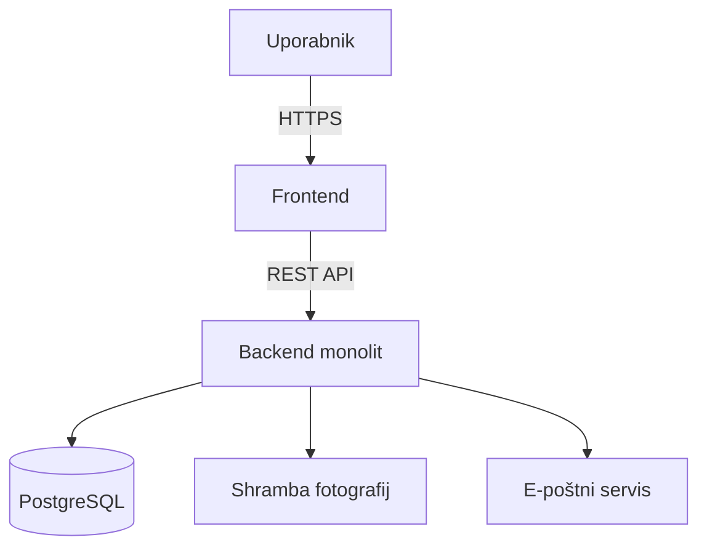
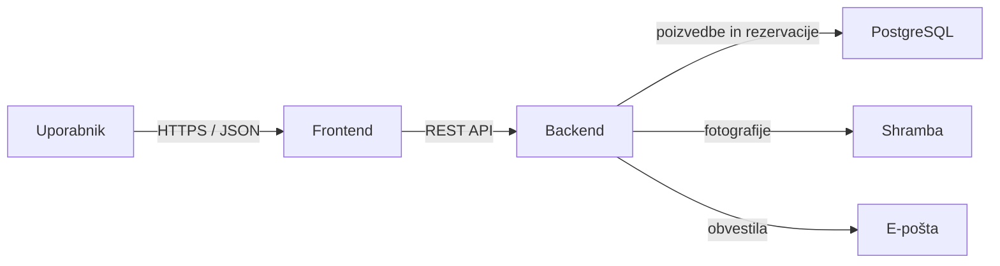

# NailBabe 💅🏽 – Arhitektura in tehnološki sklad

## 1. Arhitektura

### Glavni deli sistema

Za MVP je predvidena večplastna spletna aplikacija z enim backend servisom (monolitom). Posamezne plasti imajo ločene odgovornosti:

1. **Predstavitveni sloj (frontend):** spletna aplikacija za stranke, vodje salonov, nail artiste in administratorje.
2. **Aplikacijski sloj (backend):** REST API, poslovna logika, validacija, avtentikacija ter upravljanje rezervacij.
3. **Podatkovni sloj:** relacijska podatkovna baza za račune, salone, storitve, termine in rezervacije.
4. **Infrastrukturne storitve:** shramba fotografij in e-poštni servis.

Monolit je za MVP enostavnejši za razvoj in zagon kot več neodvisnih servisov. Meje med plastmi pa omogočajo, da se deli sistema po potrebi pozneje razširijo.

### Komunikacija med deli sistema

Frontend komunicira z backendom prek HTTPS in REST API-ja, pri čemer se podatki izmenjujejo v JSON obliki. Backend uveljavlja poslovna pravila ne glede na uporabniški vmesnik, nato pa dostopa do PostgreSQL baze. Brskalnik nima neposrednega dostopa do baze. Fotografije se nalagajo v datotečno oziroma objektno shrambo, e-poštna obvestila pa backend pošilja prek SMTP.

### Podatkovna baza

Uporabljamo **PostgreSQL** za strukturirane in med seboj povezane podatke: uporabnike, salone, storitve, razpoložljive termine in rezervacije. Relacije, tuji ključi in transakcije pomagajo ohranjati podatkovno celovitost. Rezervacija mora biti potrjena na backendu, ki preveri razpoložljivost termina in shrani spremembe tako, da sočasni zahtevki ne ustvarijo dvojne rezervacije. Podrobnejši podatkovni model je opisan v [03-podatkovni-model.md](03-podatkovni-model.md).

### Avtentikacija in upravljanje uporabnikov

Uporabnik se prijavi z e-poštnim naslovom in geslom. Gesla se hranijo samo kot bcrypt zgoščene vrednosti. Backend po prijavi izda JWT in ga preveri pri zahtevah do zaščitenih API poti. Uporabniki imajo eno od vlog: `customer`, `salon_manager`, `nail_artist` ali `admin`. Vodja salona je povezan s salonom, nail artist pa s salonovim timom; backend pri vsakem dejanju preveri tudi pripadnost salonu in dodelitev rezervacije artistu. Skrbniška vloga se dodeli nadzorovano, ne prek javne registracije. JWT skrivnost in druge poverilnice se hranijo v okoljskih spremenljivkah, ne v repozitoriju.

### Diagram arhitekture

### Preprost prikaz komunikacije

### Lokalni zagon

Za lokalni razvoj so potrebni **Node.js in npm** za frontend ter backend in **Docker z Docker Compose** za podatkovno bazo. Frontend se zažene z razvojnim strežnikom Vite, backend pa kot Node.js proces. PostgreSQL teče v lokalnem Docker vsebniku.

Predviden postopek:

1. Namestimo Node.js z npm ter Docker Desktop z Docker Compose.
2. V mapah frontenda in backenda namestimo odvisnosti z `npm install`.
3. Nastavimo lokalno datoteko `.env` s povezavo do PostgreSQL in skrivnostmi aplikacije. Te datoteke ne objavimo v GitHubu.
4. Zaženemo PostgreSQL z `docker compose up -d` in izvedemo migracije oziroma pripravimo shemo baze.
5. Zaženemo backend z razvojnim ukazom, na primer `npm run dev`.
6. Zaženemo frontend z `npm run dev` in aplikacijo odpremo na naslovu, ki ga izpiše Vite.

To so predvideni koraki. V projektu še ni datotek `compose.yaml` in `package.json`, zato bo treba ukaze uskladiti z dejansko konfiguracijo ob implementaciji.

## 2. Tehnološki sklad

| Področje | Tehnologije in orodja | Namen |
|---|---|---|
| Frontend | React, Typescript, Tailwind CSS, React Router, React Context, date-fns | SPA uporabniški vmesnik, navigacija, skupno stanje ter prikaz in obdelava datumov. |
| Razvoj frontenda | Vite | Razvojni strežnik in priprava frontend aplikacije. |
| Backend | Node.js, Express.js, JavaScript | Strežniška aplikacija in REST API. |
| Podatkovna baza | PostgreSQL; lokalno Docker, predvideno gostovanje Supabase | Relacijska hramba, transakcije in poizvedbe. |
| Avtentikacija | JWT, bcrypt | Preverjanje prijavljenih zahtev in zgoščevanje gesel. |
| Lokalni razvoj | Node.js, npm, Vite, Docker, Docker Compose | Namestitev odvisnosti, zagon razvojnih strežnikov in ponovljivo lokalno okolje za bazo. |
| Fotografije | Multer in predvidena objektna/datotečna shramba | Sprejem in hramba inspiracijskih fotografij; v bazi se hranijo reference do datotek. |
| E-pošta | Nodemailer, SMTP (npr. Mailgun), Handlebars | Pošiljanje potrditev, obvestil in opomnikov s predlogami. |
| Načrtovana opravila | node-cron | Periodično pošiljanje opomnikov. |
| Varnost | HTTPS, validacija na backendu, CORS, omejitve uploadov | Zaščita komunikacije, dostopa in vhodnih podatkov. |
| Razvoj in dostava | Git, GitHub, predvideno GitHub Actions | Verzioniranje kode in pozneje avtomatizacija preverjanj ter objave. |
| Gostovanje (predvideno) | Vercel za frontend, Supabase za PostgreSQL | Gostovanje uporabniškega vmesnika in upravljane baze. |

## 3. Arhitekturne odločitve

| Odločitev | Utemeljitev |
|---|---|
| En backend monolit z ločenimi plastmi | MVP ima omejen obseg; enostavnejša namestitev in razvoj, meje plasti pa omogočajo poznejše širjenje. |
| PostgreSQL za transakcijske podatke | Relacije, tuji ključi, transakcije in sočasno zaklepanje podpirajo zanesljivo upravljanje terminov. |
| JWT in vloge na backendu | API lahko preveri identiteto in dovoljenja pri vsaki zahtevi; vloga sama ne nadomesti preverjanja lastništva. |
| Fotografije v ločeni shrambi | Slike so ločene od strukturiranih podatkov, v bazi pa ostanejo le reference in metapodatki. |
| E-pošta prek SMTP | Enoten kanal zadostuje za MVP potrditve in opomnike; ponudnika je mogoče zamenjati brez spremembe glavne poslovne logike. |
| Backend in baza potrjujeta rezervacijo | Preverjanje termina samo v uporabniškem vmesniku ne zadostuje ob sočasnih zahtevah; transakcijska obdelava preprečuje dvojno rezervacijo. |
| Docker Compose za lokalno bazo | Razvijalci lahko uporabljajo enako različico in konfiguracijo PostgreSQL brez ročne namestitve lokalne baze. |
