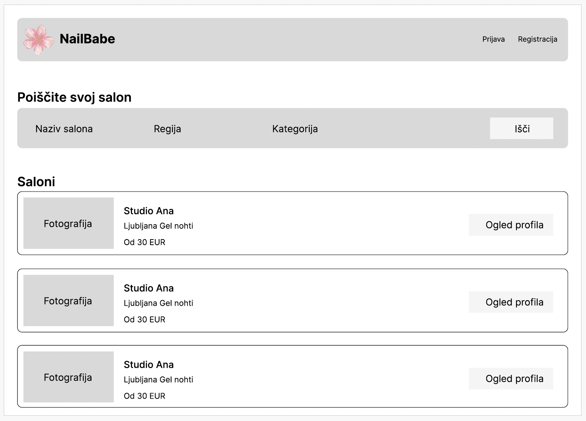
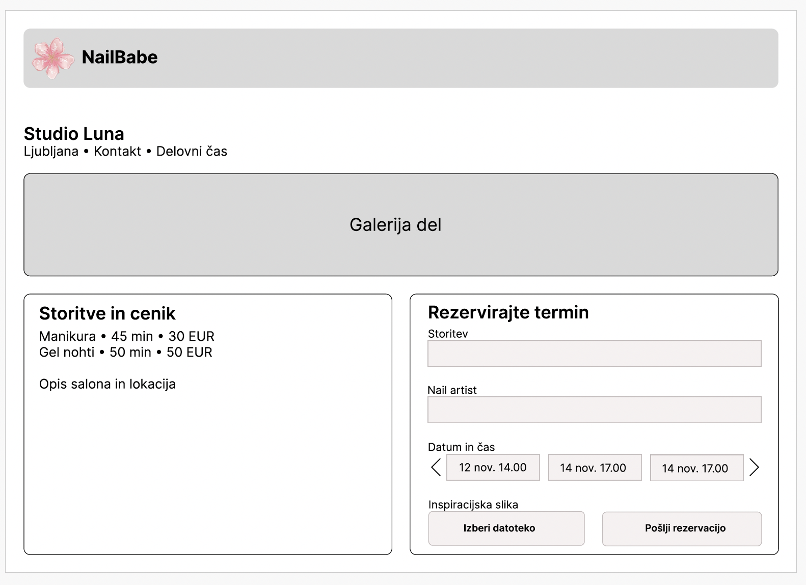
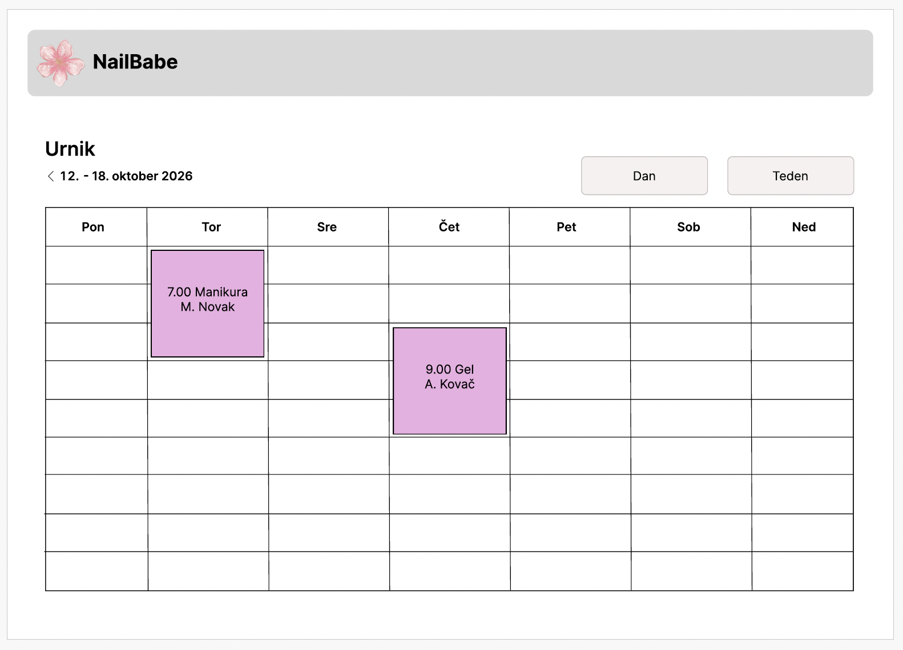

# Wireframes – NailBabe

Spodnje skice prikazujejo glavne zaslone načrtovane spletne aplikacije. Gre za strukturne wireframe prikaze; ne določajo končnih barv, tipografije ali vizualne podobe.

## 1. Iskanje salonov

Začetni pogled stranki omogoča iskanje po nazivu, regiji in kategoriji. Rezultati vsebujejo osnovne podatke o salonu in povezavo do njegovega profila.

## 2. Profil salona in rezervacija

Profil združuje galerijo, opis, lokacijo, seznam nail artistov in njihove specializacije, storitve s cenami ter obrazec za izbor storitve, artista in njegovega prostega termina. Stranka lahko priloži inspiracijsko fotografijo.

## 3. Urnik nail artista in ekipe

Nadzorna plošča nail artista prikazuje njegove rezervacije, vodji salona pa omogoča pregled urnika celotne ekipe. Pogled omogoča preklop med dnevnim in tedenskim prikazom ter premik med obdobji.
